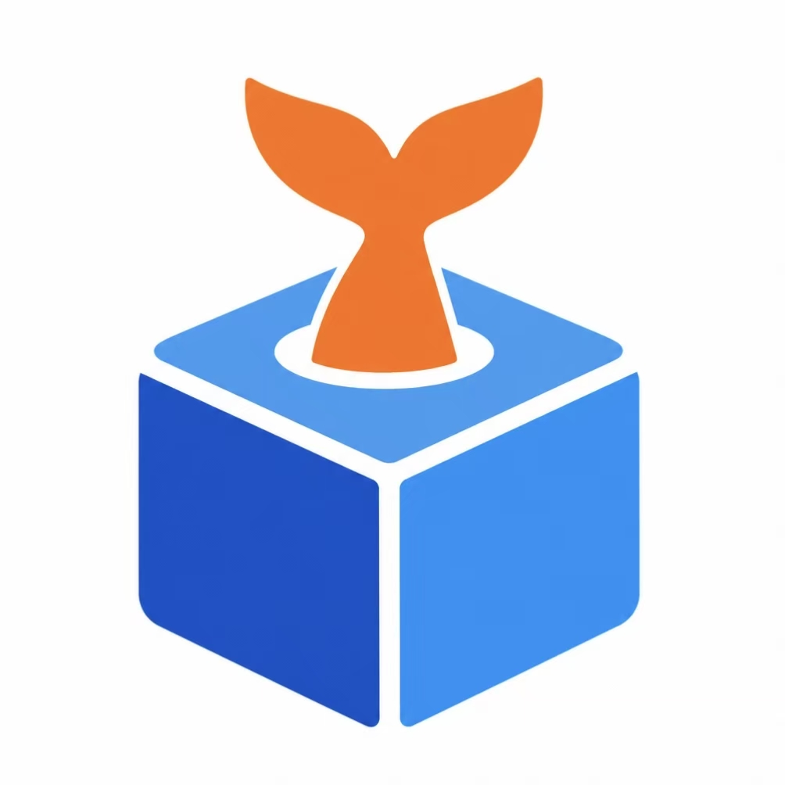

<p align="center"></p>

# pbox · 手机短信沙盒

> 第三方把短信投递到本地 server 落库，手机 App 每秒轮询取走。
> 不调用运营商、不真实下发短信，用于验证码流程联调、演示与自动化测试。

pbox 是一个**局域网内自托管**的手机短信沙盒：业务系统通过 HTTP 把短信写进你的数据库，你的手机端把它当作真实收件箱来读取。适合在没有真机号卡、不想花钱买短信、或需要反复复现验证码流程的场景。

## 特性

- **短信投递 / 轮询 / 已读 / 软删除**完整闭环，只落库不发真短信
- **特殊发送方**：登记手机号后获得 `apiCode`，走 `/sms/send-api` 投递时校验来源，可显示发送方昵称
- **沙盒手机号白名单**：只有登记过的号码才能在 App 中使用
- **自带 Web 管理页**：浏览器打开 `http://{ip}:8080/` 即可注册手机号、管理发送方
- **游标增量拉取**：`afterId` 续传，重复轮询不会重复消费，断线可接续
- **局域网内多台手机可接入**，按已登记手机号收信，无需公网、无需推送服务

## 工作原理

```text
第三方 / 业务系统 ──POST /sms/send·send-api──▶  pbox-server (8080)  ──▶  MySQL 8
                                              ▲
                        Android App ──GET /sms/messages（每 1 秒）──┘
```

## 环境要求

| 组件 | 版本 | 说明 |
| --- | --- | --- |
| JDK | 21 | 运行 server |
| MySQL | 8.x | 库名 `pbox`，字符集 `utf8mb4` |
| Android Studio | SDK 36 | 仅编译 App 时需要 |
| 手机与电脑 | 同一局域网 | 关闭路由器 AP 隔离 |

> 不想安装 JDK / MySQL？装好 [Docker Desktop](https://www.docker.com/products/docker-desktop/) 后直接用下面的「方式二」，一条命令起服务端和数据库。

## 快速开始

### 方式一：本机 JDK + MySQL

1. **建库**（只建库，表由 Flyway 在启动时自动创建）

   ```powershell
   mysql -u root -p < sql/001-create-database.sql
   ```

2. **准备配置**

   ```powershell
   New-Item -ItemType Directory -Force a_run_env
   Copy-Item a_run_env_example\pbox.env a_run_env\pbox.env
   ```

   然后编辑 `a_run_env/pbox.env`，把 `PBOX_DB_PASSWORD` 改成你自己的数据库密码。

3. **启动 server**（必须在仓库根目录执行）

   ```powershell
   .\gradlew :server:bootRun
   ```

   启动日志会打印 Wi-Fi 网卡的地址，形如：
   `pbox server listening on hostname: http://192.168.x.x:8080  [WLAN]`

4. **登记手机号**

   浏览器打开 `http://{ip}:8080/`，在「手机号」页注册 App 要使用的号码。

5. **连接手机**

   从 [Releases](https://github.com/Feseis/fish-pbox/releases) 下载 `phonebox-<版本>.apk` 安装，填入 `{ip}:8080` 与上一步登记的号码，点「连接」。

> 详细的验收命令、curl 示例与排障，见 [docs/GETTING-STARTED.md](docs/GETTING-STARTED.md)。

### 方式二：Docker 一键启动

前提：已安装并启动 Docker Desktop，**无需 JDK / MySQL**。

1. **准备配置**（与方式一第 2 步相同）

   ```powershell
   New-Item -ItemType Directory -Force a_run_env
   Copy-Item a_run_env_example\pbox.env a_run_env\pbox.env
   ```

   把 `a_run_env/pbox.env` 里的 `PBOX_DB_PASSWORD` 改成任意密码，容器首次启动会用它初始化数据库。容器模式下的 `PBOX_DB_URL` / `PBOX_DB_USERNAME` 由 `compose.yaml` 覆盖，无需改动。

2. **启动**（必须在仓库根目录执行，首次会构建镜像）

   ```powershell
   docker compose --env-file a_run_env/pbox.env up -d --build
   ```

3. **等待就绪**

   ```powershell
   docker compose --env-file a_run_env/pbox.env logs -f pbox
   ```

   看到 `Started PboxServerApplication` 后按 `Ctrl+C` 退出日志。Flyway 会自动建表，无需手工执行 SQL。

4. **登记手机号 / 连接手机**：同方式一第 4、5 步，IP 见下一节。

> 常用命令：`docker compose down` 停止（数据保留）；`docker compose down -v` 停止并**清空数据库**。

### 获取局域网 IP

用 Docker 启动时，server 运行在容器内，日志不会打印宿主机 IP，需要在宿主机自行查询：

```powershell
ipconfig
```

在输出里找「无线局域网适配器 WLAN」下的 `IPv4 地址`，形如 `192.168.1.23`。也可以让 PowerShell 自动列出来（已过滤 Hyper-V / WSL 等虚拟网卡）：

```powershell
Get-NetAdapter -Physical | Where-Object Status -eq 'Up' |
  ForEach-Object { Get-NetIPAddress -InterfaceIndex $_.ifIndex -AddressFamily IPv4 } |
  Select-Object InterfaceAlias, IPAddress
```

手机与电脑连同一个 Wi-Fi，在 App 中填入 `192.168.1.23:8080`。

## 接口一览

| 方法 | 路径 | 用途 |
| --- | --- | --- |
| `POST` | `/sms/send` | 手机号用户投递短信（USER 渠道） |
| `POST` | `/sms/send-api` | 特殊发送方投递短信（API 渠道） |
| `GET` | `/sms/messages` | App 拉取短信（按 `afterId` 增量） |
| `POST` | `/sms/messages/read` | 标记已读 |
| `DELETE` | `/sms/messages/{id}` | 软删除短信 |
| `POST` | `/sms/senders` | 注册特殊发送方，返回 `apiCode` |
| `GET` | `/sms/senders` | 查看发送方列表 |
| `PUT` | `/sms/senders` | 修改发送方名称 |
| `DELETE` | `/sms/senders` | 删除发送方 |
| `POST` | `/sms/phones` | 登记沙盒手机号 |
| `GET` | `/sms/phones` | 查看沙盒手机号 |
| `DELETE` | `/sms/phones` | 删除沙盒手机号 |
| `GET` | `/sms/health` | 健康检查（含数据库状态） |

完整请求/响应字段与错误码见 [docs/API.md](docs/API.md)。

## 构建

```powershell
# 服务端可执行 jar
.\gradlew :server:bootJar
# 产物：server\build\libs\*.jar

# Android APK
.\gradlew :phonebox:assembleDebug
# 产物：phonebox\build\outputs\apk\debug\phonebox-debug.apk

# 服务端 Docker 镜像（构建阶段自动执行 bootJar，无需本机 JDK）
docker build -t pbox:latest .
```

macOS / Linux 下把 `.\gradlew` 换成 `./gradlew`。

## 目录结构

```text
fish-pbox/
├── server/                     Spring Boot 服务端（端口 8080）
│   └── src/main/resources/
│       ├── db/migration/       Flyway 建表脚本（启动时自动执行）
│       └── static/             内置 Web 管理页
├── phonebox/                   Android 客户端（com.feseis.phonebox）
├── docs/
│   ├── API.md                  接口契约
│   └── GETTING-STARTED.md      本地启动与排障
├── sql/
│   └── 001-create-database.sql 建库脚本
├── a_run_env_example/
│   └── pbox.env                环境变量模板
├── compose.yaml                Docker Compose：一条命令起 server + MySQL
├── Dockerfile                  服务端镜像（多阶段构建）
├── gradle/                     Gradle Wrapper
├── build.gradle.kts
└── settings.gradle.kts
```

## 已知限制

- **无鉴权**：首版接口不校验身份，仅限可信局域网使用，**禁止把 8080 暴露到公网**。
- **不绑定设备**：局域网内任意能连到 server、且使用已登记手机号的 app 都可接入；准入只靠手机号白名单，服务端不校验请求方是否为号码持有者。
- **Android 9+ 默认禁止明文 HTTP**：局域网 `http://` 仅适用于调试场景，生产环境需自行配置 HTTPS。

## 文档

| 文档 | 内容 |
| --- | --- |
| [docs/API.md](docs/API.md) | 接口契约、请求/响应示例、错误码 |
| [docs/GETTING-STARTED.md](docs/GETTING-STARTED.md) | 建库、启动、验收 curl、常见故障排查 |
| [sql/001-create-database.sql](sql/001-create-database.sql) | 建库脚本（表由 Flyway 管理） |

## License

[MIT](LICENSE) © 2026 Feseis
